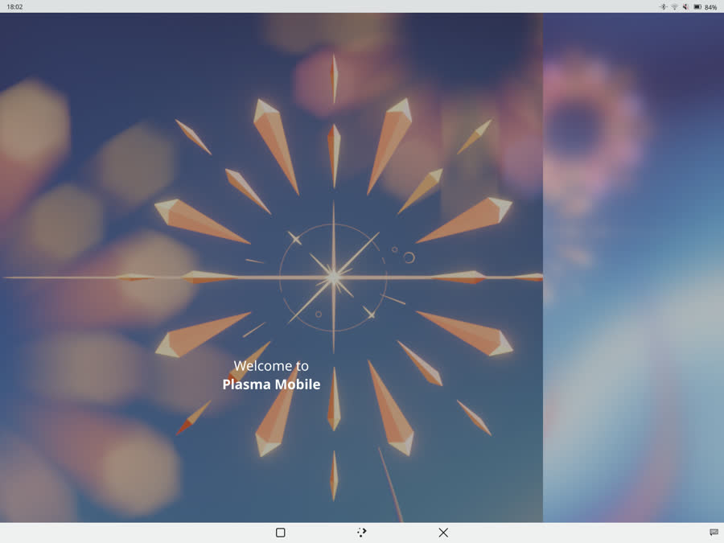
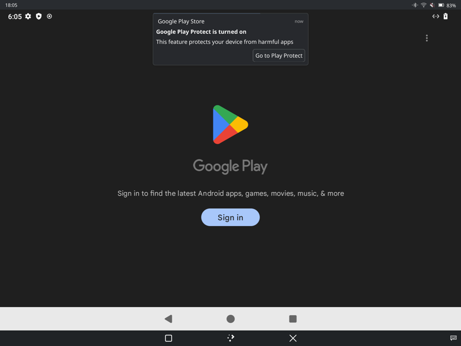
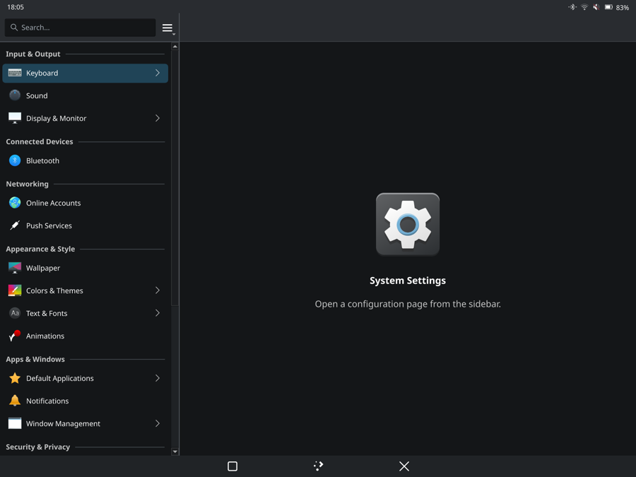

# Plasma Mobile session (experimental)

Install Plasma Mobile alongside GNOME and switch sessions with `dc1-session`.
GNOME remains the default. Plasma installation is optional and separate from
the rootfs build.

## Why Plasma Mobile

At 1.5× scaling, the DC-1's 1200×1600 panel is 800×1067 logical pixels,
above GNOME Mobile's `_checkIsPhone()` thresholds (500/1000). GNOME therefore
uses its desktop layout with mobile keyboard and rotation patches.

Plasma Mobile provides touch navigation, maximized apps, a card-based task
switcher, Plasma Keyboard and Waydroid controls in quick settings.







Screenshots: `spectacle -b` inside the session, 1200×1600 panel at 1.5× in
landscape, scaled to 900 px wide.

## Install (on the tablet)

```sh
pkexec /bin/sh "$(pwd)/scripts/plasma-mobile-install.sh"   # apk add postmarketos-ui-plasma-mobile plasma-keyboard
dc1-session --now plasma-mobile            # ends the current desktop session
```

`dc1-session` writes the AccountsService `Session` key because gdm autologin
never shows its chooser. `dc1-session --now gnome` returns; `--list` shows
the installed sessions. `scripts/plasma-mobile-remove.sh` uninstalls.

If Plasma's lock screen asks for a **PIN**, enter your **Linux account password**
—the one created during installation. It does not use a separate numeric PIN.
Tap the keyboard icon to switch from the number pad to the full keyboard.

## Device and installer changes

- `dc1-orientation` exits under KWin, which handles sensor rotation itself.
  It checks both the desktop environment and the `org.kde.KWin` bus name:
  the service can start before Plasma imports its environment. Exit status 3
  prevents systemd from restarting the bridge.
- The installer disables the unused fingerprint PAM service with `pam_deny.so`.
  The DC-1 has no fingerprint reader. Password authentication is unchanged;
  removal restores the saved profile. This does not establish a fix for the
  separate password-authenticator hang.
- `/usr/bin/dc1-session` selects the next login session and can switch immediately.
- Unless a user already has `~/.config/kscreenlockerrc`, the installer creates
  it with locking disabled at login, after idle time and on resume. This
  matches the current GNOME setup. Enable locking in **Settings → Screen Locking**.

The GNOME-only pieces — `dc1-safe-area`, `dc1-session-compat`,
`dc1-warmth`, the Mutter `kms-modifiers` setting and the gschema overrides —
do not apply under KWin. Bezel insets, the GPU/charging settings panels
(GTK apps; they still launch) and the OSK-on-greeter override have no Plasma
counterpart yet.

## Acceptance checks

Record results in this section as they are taken on hardware.

| Check | Result |
| --- | --- |
| Session starts from gdm autologin after `dc1-session --now plasma-mobile` | 2026-10-25: yes; kwin_wayland + plasmashell on seat0, first login landed on the lock screen (fixed above) |
| Touch, pen and auto-rotation (KWin via iio-sensor-proxy) | 2026-10-25: rotation applied by KWin (`Rotation: 2`, landscape geometry); owner reports the session works well; no per-input measurement yet |
| Scale (KWin auto-scale vs. the 1.5× GNOME default) | 2026-10-25: KWin picked 1.25× and the 120 Hz mode (`kscreen-doctor -o`); the port prefers 60 Hz, not yet changed |
| Plasma Keyboard appears for text fields; lock screen unlock by touch | 2026-10-25: keyboard works. Unlock **failed** with the correct password until `/etc/tcb` was made traversable (device package shipped it 0700; musl `getspnam()` then fails with EACCES for non-root callers and `unix_chkpwd` logs `check pass; user unknown`). Fixed in 1-r117; after the fix `unix_chkpwd` returns 0/7 for correct/wrong. The same bug would hit swaylock under the Sway session |
| Wi-Fi, Bluetooth, audio from quick settings | pending |
| Waydroid container toggle and app cards in the task switcher | 2026-10-25: cards work (Play Store, launcher). Waydroid sizes its display once at container start and does not follow later KWin rotation or scale/mode changes; the owner saw a portrait Android inside a landscape session until the container was stopped and started again. Try `waydroid prop set persist.waydroid.multi_windows true` before treating this as a port bug |
| `dc1-orientation` stopped (exit 3), no restart loop in `journalctl --user` | 2026-10-25: yes via the `org.kde.KWin` bus check; `ActiveState=inactive`, `NRestarts=0` |
| Return with `dc1-session --now gnome`; GNOME extensions and rotation recover | pending |
